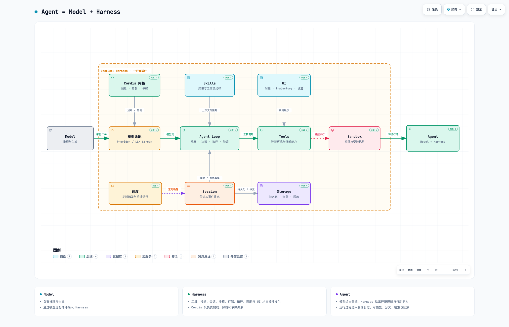
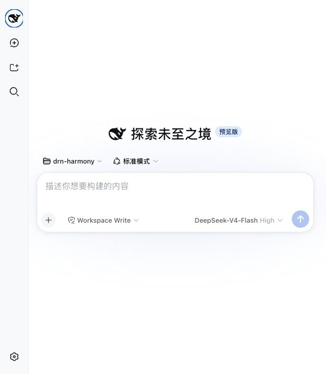
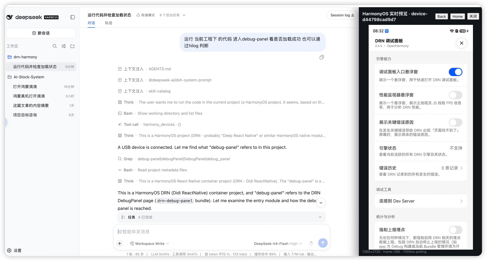
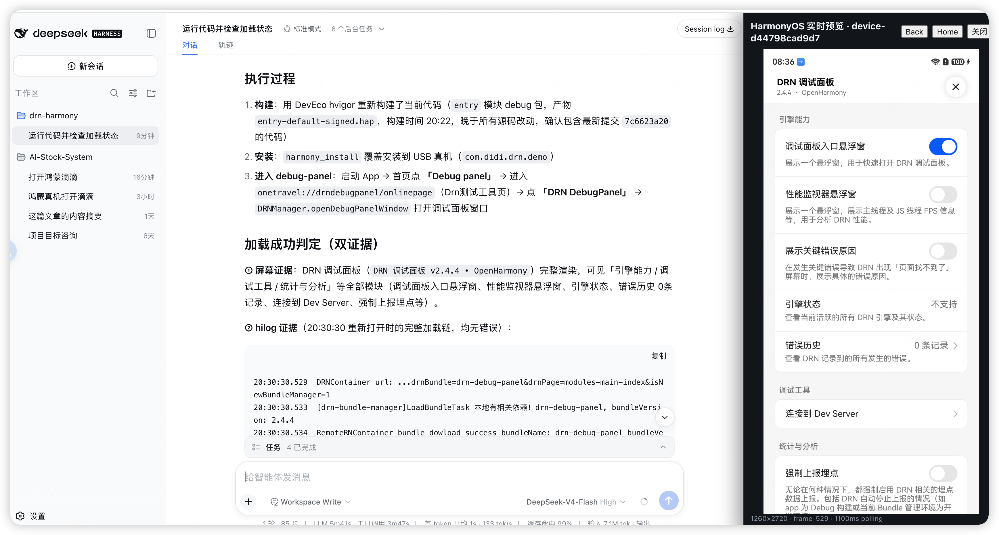
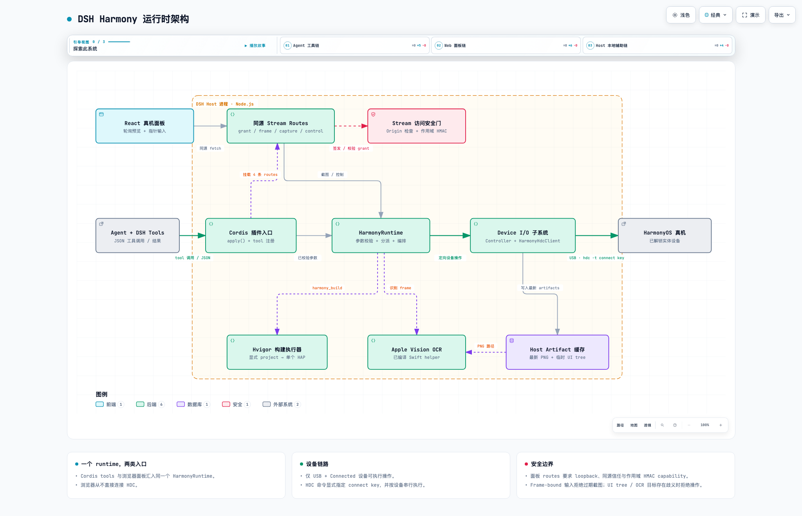
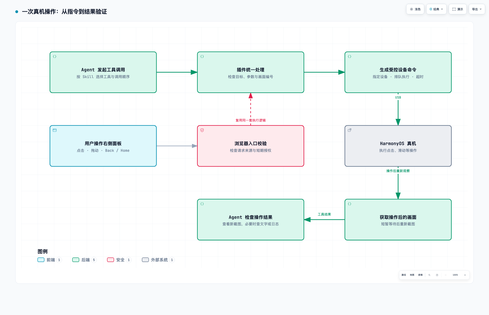
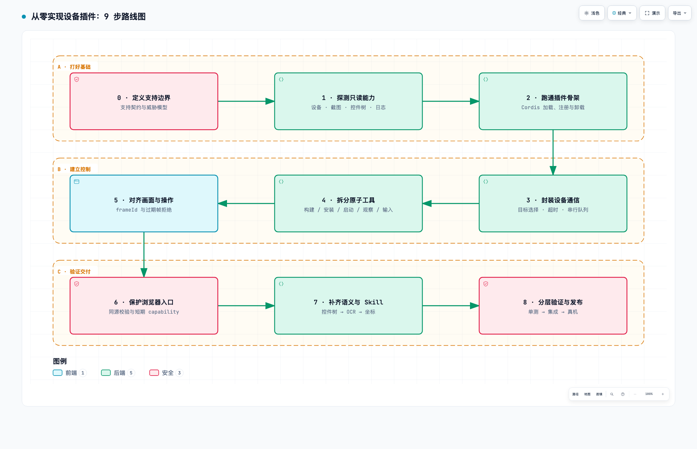

# 从“能对话”到“能操作真机”：DeepSeek Harness 使用、插件机制与 HarmonyOS 插件实战

> 本文基于 2026 年 9 月 4 日的 DeepSeek Harness 开发者预览版，以及 `dsh-harmony 0.1.0-rc.1` 的本地实现。Harness 的核心插件和基础 API 仍可能发生不兼容变更，正式接入前应重新核对官方文档。

把一台 HarmonyOS 手机用 USB 接到电脑上，然后对 Agent 说：

> 找到已连接的设备，构建当前工程，把 HAP 安装到手机，启动应用，点击“下一步”，最后检查日志里有没有 error。

这句话看起来像一个普通提示词，背后却横跨模型、工程构建、设备发现、应用安装、UI 理解、输入控制、日志读取和安全确认。模型本身不会做这些事。真正把意图变成可靠动作的，是 Harness。

DeepSeek 对它的概括很简洁：

```text
Agent = Model + Harness
```



> [打开 Archify 交互版](../artifacts/agent-model-harness.html)：支持明暗主题、缩放、搜索、路径追踪、证据查看和图片导出。

模型负责推理，Harness 负责让模型理解环境、使用工具，并在真实场景里持续工作。DeepSeek Harness 更值得关注的地方，不只是又多了一个 Coding Agent，而是它把模型、工具、技能、会话、沙箱、存储、循环、调度和 UI 都放进了同一个插件体系。

这篇文章分三部分：先跑起来，再看懂插件，最后拆解一个把 HarmonyOS 真机接入对话的完整案例。

## 一、先用起来：5 分钟跑通 DeepSeek Harness

DeepSeek Harness 当前处于开发者预览阶段，最快的启动方式只需要 Node.js：

```bash
npx @deepseek-ai/dsh web
```

默认情况下，Web UI 会运行在 `http://127.0.0.1:3080`。如果是在 SSH 环境中启动，它只打印地址；如果不希望自动打开浏览器，可以加 `--no-open`。



*DeepSeek Harness Web UI：首页集中提供工作区、运行模式、访问权限和模型选择。*


### 四种运行模式怎么选

官方页面目前展示了四种模式：

| 模式 | 适合什么任务 |
| --- | --- |
| 标准模式 | 完整编码任务，包含文件、Shell、检索、Skills、计划、目标、子 Agent 和工作流 |
| PTC 模式 | 让模型用一段 TypeScript 程序编排多轮工具调用，适合步骤多、工具结果需要继续加工的任务 |
| 极简模式 | 只保留持久 Bash 和文件编辑工具，适合最小环境下的模型能力测试 |
| 创造模式 | 检查当前运行时、试验 Cordis 插件，并据此创建自定义 Agent preset |

普通研发任务从标准模式开始就够了。需要连续查询、汇总和条件分支时再考虑 PTC；要做基准测试时使用极简模式；要改变 Agent 的能力组合时，才进入创造模式。

## 二、插件不是附件，而是 Harness 的基本单位

DeepSeek Harness 的架构可以压缩成三句话：

- Cordis 内核只负责插件的加载、卸载和依赖关系。
- Agent 的具体能力由插件提供，并通过服务和事件协作。
- 开发者通过配置组合能力，不必修改 Harness 核心源码。

一个最小插件只是导出 `name` 和 `apply()` 的 TypeScript 模块：

```ts
import type { Context } from '@deepseek-ai/cordis'

export const name = 'hello-plugin'

export function apply(ctx: Context) {
  console.log('[hello-plugin] loaded')
}
```

如果插件需要工具注册表，就声明依赖并注册 Tool：

```ts
import type { Context } from '@deepseek-ai/cordis'
import { defineTool } from '@deepseek-ai/dsh-tools'

export const name = 'greet-tool'
export const inject = ['tools']

export function apply(ctx: Context) {
  ctx.tools.register(defineTool({
    name: 'greet',
    description: 'Greet someone by name.',
    parameters: {
      name: { type: 'string', required: true },
    },
    output: {
      schema: { type: 'string' },
      render: (_args, value) => [{ type: 'text', text: value }],
    },
    async execute(args) {
      return `Hello, ${args.name}!`
    },
  }))
}
```

这段代码里有四个关键契约：

1. `inject` 声明插件需要哪些服务，Cordis 会等待依赖就绪后再加载它。
2. `parameters` 是给模型看的输入边界，也是运行时校验边界。
3. `execute` 产生规范结果，`render` 决定结果如何进入模型上下文或 UI。
4. 注册、事件监听和定时器都属于可逆副作用；插件卸载或热替换时，Cordis 会撤销这些 effect。

### Plugin、Bundle 和 Profile 不要混为一谈

插件是运行单元，bundle 是分发与配置单元，profile 是可启动的能力组合。

```text
Plugin  -> 导出 apply()，注册能力
Bundle  -> npm 包 + dsh.bundle + cordis.patch.yml
Profile -> 一组有序 Bundle + 用户自己的配置层
```

一个可安装 bundle 的 `package.json` 会声明：

```json
{
  "name": "dsh-hello-plugin",
  "version": "0.1.0",
  "type": "module",
  "main": "index.js",
  "dsh": {
    "bundle": {
      "patch": "./cordis.patch.yml"
    }
  }
}
```

`cordis.patch.yml` 决定把哪个插件节点插入配置树：

```yaml
- insert:
    - id: hello
      name: dsh-hello-plugin
```

然后把 bundle 安装进一个 profile：

```bash
dsh plugin --profile demo add ./hello-plugin
dsh --profile demo --dump-config
dsh --profile demo
```

这套分层很重要。插件作者交付默认能力，用户可以在 profile、home 或命令行 `--patch` 层覆盖配置，不必 fork 插件。需要注意的是，后层 patch 会替换目标行的整个 `config`，并不是逐字段深度合并。

如果从 GitHub 安装 TypeScript 插件，还要特别处理构建产物：Git 安装不会自动拥有 `lib/`，作者需要提供自包含的 `prepare`；pnpm 10 及以上又要求用户显式允许依赖在安装时执行构建脚本。更稳妥的分发方式是发布已经构建好的 npm 包或 tarball。

### 热门社区插件

**改界面**

- [dsh-visualize](https://github.com/Nagi-ovo/dsh-visualize) 让模型把交互式 HTML 卡片直接渲染进会话流，并提供流式预览与沙箱化展示。
- [dsh-TUI](https://github.com/ccch1mneyyy/dsh-TUI) 提供带鲸鱼顶栏、实时状态、流式思考和上下文进度的全屏终端界面。
- [dsh-deep-whale](https://github.com/Small-tailqwq/dsh-deep-whale) 是一组面向 Web UI 的“鲸鱼娘”系列皮肤。
- [dsh-balance-meter](https://github.com/Ghost011118/dsh-balance-meter) 在输入区域显示 DeepSeek 账户余额与当前会话花费。

**自进化**

- [dsh-evolve](https://github.com/william-jin-cmu/dsh-evolve) 允许 Agent 在会话内为自己热挂载持久化 Cordis 插件，也能可逆卸载，并在重启后恢复。
- [dsh-continual-evolve](https://github.com/ZK-Andy/dsh-continual-evolve) 从会话轨迹中持续提炼版本化、可审计、可回滚的 Harness 状态，并用基准验证约束演化结果。

**改能力**

- [dsh-computer-use](https://github.com/Anionex/dsh-computer-use) 通过 Accessibility 观察、过期状态拒绝和作用域权限，让 Agent 在受控边界内操作 macOS。
- [dsh-data-agent](https://github.com/omdsh-dev/dsh-data-agent) 把数据库连接、Schema 理解和 SQL 分析接入对话，让 Agent 可以用自然语言完成数据查询。
- [dsh-docker](https://github.com/Jesse-njx/dsh-docker) 提供结构化、带护栏的 Docker 与 Compose 操作；破坏性动作经过审批门，并携带项目与服务健康状态。
- [dsh-toolkit](https://github.com/omdsh-dev/dsh-toolkit) 一次安装十个零依赖确定性工具，覆盖时间、编码、JSON、计算、CSV、正则、Markdown、Diff、统计和 Schema。

发现更多插件，可以从社区维护的 [awesome-dsh-plugin](https://github.com/awesome-dsh-plugin/awesome-dsh-plugin) 开始，也可以直接浏览 GitHub 的 [`dsh-plugin` Topic](https://github.com/topics/dsh-plugin)。

## 三、案例：把 HarmonyOS 真机接入 DeepSeek Harness



*过程视图：会话流展示上下文注入、项目检索和 `harmony_devices` 工具调用，右侧同步显示真机状态。*


*结果视图：Agent 完成构建、安装和页面打开，并结合右侧 HarmonyOS 实时预览与 HiLog 给出加载成功证据。*


`dsh-harmony` 的目标不是提供一条万能的远程 Shell，而是给 Agent 一组边界清晰、可以组合的 HarmonyOS 真机能力：发现设备、构建 HAP、安装和启动应用、读取日志、获取截图、理解 UI 并执行输入。

插件始终注册 18 个工具：

| 领域 | Tools |
| --- | --- |
| 设备与能力 | `harmony_devices`、`harmony_capabilities` |
| 构建与应用 | `harmony_build`、`harmony_install`、`harmony_launch`、`harmony_list_apps`、`harmony_app_info` |
| 画面与操作 | `harmony_screenshot`、`harmony_interact` |
| 控件树 | `harmony_ui_tree`、`harmony_tap_element`、`harmony_ui_rows`、`harmony_tap_row` |
| OCR | `harmony_find_text`、`harmony_tap_text`、`harmony_wait_for` |
| 诊断 | `harmony_logs`、`harmony_processes` |

“始终注册”比“探测到设备后再注册”更适合 Agent：工具集合保持稳定，能力缺失时返回明确错误或降级信息，模型不会因为一次断连突然面对另一套 schema。

### 安装与启动

插件要求 Node.js 23.11 及以上、可执行的 HDC/Hvigor/HarmonyOS SDK，以及一台已解锁并完成 USB 调试授权的 HarmonyOS 真机。OCR 使用 macOS Apple Vision，因此只有 macOS Host 提供 OCR，其余工具不依赖 OCR。

在插件仓库中构建，并加入 `web` profile：

```bash
pnpm install
pnpm run build
dsh plugin --profile web add /absolute/path/to/dsh-harmony
dsh web
```

安装后可以给 Agent 一个完整、可验证的任务：

> 使用 Harmony 工具检查 USB 设备及能力。构建当前 HarmonyOS 工程并告诉我 HAP 路径，但先不要安装。

确认构建结果后，再继续：

> 把刚才的 HAP 安装到唯一的 USB Connected 设备，启动 `com.example.demo` 的 `EntryAbility`。读取控件树，唯一匹配到“下一步”后点击，并用新截图或等待条件确认页面已经变化。最后读取该 bundle 的 HiLog，只返回包含 error 的行。

这个提示词刻意把“构建”“安装”“操作”“验证”分成了可观察步骤，也要求优先使用语义控件而不是盲点坐标。

### 运行时架构



整个插件只有一个 `HarmonyRuntime`，但有两类入口：

```text
Agent / DSH Tools
        |
        v
Cordis apply() -> HarmonyRuntime -> Device Controller -> HDC -> USB 真机
                          |                |
                          |                +-> PNG / UI tree cache
                          +-> Hvigor / OCR

React 真机面板 -> 同源 Routes -> 安全门 -> 同一个 HarmonyRuntime
```

浏览器面板不会直接连接 HDC。Agent 工具和 Web 面板最终进入同一个 Runtime，因此设备选择、帧状态、输入校验和错误语义不会产生两套实现。

## 四、关键点：HarmonyOS 真机插件的实现要点与设计取舍

“运行应用，打开调试面板，并确认加载成功。”这句话交给人，只需要看手机、点按钮、检查结果；交给 Agent，就需要把这些动作逐个说清楚：操作哪台手机？按钮在哪里？截图是不是旧的？执行完以后，凭什么判断成功？

`dsh-harmony` 围绕这些问题做了六个设计。先看一次操作如何经过插件、到达真机，再把结果带回会话：



*上方是 Agent 的操作路径；左下方是用户从预览面板操作的入口。两种入口共用插件的执行逻辑。右下方展示 Agent 工具调用后的结果验证。*

[打开 Archify 交互版](./assets/harmony-key-design.html)，可放大查看各环节与连线。

### 1. 先分工：入口负责接入，运行时负责处理

插件刚加载时，要把设备工具注册到 Harness，把右侧面板需要的接口接起来。这部分由入口文件完成，可以理解为把各个部件连接好。

真正处理请求的是 `HarmonyRuntime`。例如收到“点击调试面板”的工具调用后，它负责检查参数、找到目标，再交给设备控制层执行。工具的名称、参数和说明则集中放在另一份工具定义中。

这样分工后，修改 Web 面板时可以复用设备操作逻辑；增加一个工具时，也有明确的位置放参数和实现。Agent 调用工具、用户点击右侧面板，最终都进入同一个 Runtime，使用同一份设备与截图状态。

这个设计的取舍是多划分了几层代码，换来的是更容易定位问题：接入失败查入口，参数错误查 Runtime，设备命令失败查通信层。

### 2. 动手之前，先确认操作的是哪台手机

假设电脑同时连接了两台手机，Agent 说“安装应用”。如果程序直接使用列表中的第一台，结果就取决于设备枚举顺序，很容易装错。

因此，插件只操作通过 USB 连接、状态为 `Connected` 的设备。只有一台符合条件时可以自动选择；存在多台时，调用方必须明确指定目标。之后每条设备命令都带上目标设备标识。

HDC 是电脑与 HarmonyOS 设备通信的工具。插件把“截图、安装、点击”等有限动作转换成经过校验的命令参数，再启动 HDC。同一台设备的 HDC 命令按队列执行，并设置超时和输出大小上限，减少并发干扰，也避免一次卡住的命令拖住整个任务。

设备的原始连接标识留在本机通信层，对话和面板使用脱敏后的编号。这一层解决的是：**选对设备、按顺序执行、失败时能够停下来并说明原因。**

### 3. 点击时，要带上“我是看着哪张图点的”

Agent 在截图里看到一个按钮，不代表手机此刻还停在同一画面。弹窗、页面跳转或屏幕旋转，都可能让原来的坐标失去意义。

插件因此给截图分配一个编号 `frameId`，并记录尺寸、方向和拍摄时间。坐标点击必须带上所依据的截图编号。下面的编号仅用于说明：

| 发生了什么 | 插件如何处理 |
| --- | --- |
| Agent 看到 `frame-41`，当前保存的也是 `frame-41` | 通过帧编号检查，继续校验并执行 |
| 新截图已经更新为 `frame-42`，点击仍引用 `frame-41` | 拒绝这次操作，要求重新观察 |
| 点击执行完成 | 短暂等待后重新截图，把新画面交回 Agent |

坐标用 0 到 1 的比例表示，例如 `(0.5, 0.5)` 表示画面中心，再按这张截图的尺寸换算成像素，避免把预览窗口的大小当成手机屏幕大小。

这里也有一个实际边界：`frameId` 能发现“引用的截图已被更新”，不能自动发现手机在两次截图之间发生的所有变化。所以操作前要尽量获取新画面，操作后还要检查结果。多一次截图会增加耗时，但能让下一步建立在新的观察上。

### 4. 找按钮时，先找控件，再认文字，最后用坐标

以“打开 Debug panel”为例，插件推荐先读取控件树。控件树可以理解成系统提供的一份界面元素清单，包含按钮的标识、文字、位置和状态。如果能唯一找到目标，就可以根据它的位置执行点击。

有些页面的文字由自定义组件绘制，控件树里看不到。这时再用 OCR，从截图中识别文字。若两种方法都无法找到目标，才使用最新截图上的坐标。

| 找目标的方法 | 通俗理解 | 适用情况 |
| --- | --- | --- |
| 控件树 | 从界面元素清单中找到按钮 | 系统能提供控件标识或文字 |
| OCR | 从图片里把文字认出来 | 看得到文字，控件树却没有记录 |
| 截图坐标 | 根据画面确定点击位置 | 图标、画布等无法用前两种方法定位的区域 |

如果页面上有两个“确定”，按文字查找就会得到多个结果。插件会拒绝这次点击，Agent 需要补充控件标识、缩小查询条件，或在确认列表内容后明确选择某一行。对于控件目标，还会检查它是否可见、可用，以及是否具有有效的点击区域。

本插件的 OCR 在 macOS 本机完成。不具备 OCR 能力时，截图和其他基础工具仍可使用。这样的优先顺序，让 Agent 能根据实际能力逐步选择定位方式。

### 5. 右侧面板也要经过校验，才能控制手机

在右侧预览里点击按钮，相当于用户通过浏览器发出设备操作请求。浏览器先访问插件提供的本地接口，由接口检查请求来源与授权，再交给同一个 Runtime 执行。

这里的 `capability` 可以理解成一张有有效期、限定设备和用途的通行证。例如，读取截图与控制设备使用不同用途的凭证，最长有效期为 10 分钟。接口还会检查请求是否来自允许的本地来源；读取截图文件时，只允许访问指定缓存目录内符合条件的文件。

这层设计把“浏览器能发请求”和“请求可以控制设备”分开处理，也让面板复用工具层已有的设备选择、参数校验和旧帧检查。

预览采用定时截图刷新。当前实现是在一轮截图请求结束后，再等待约 1100 ms 发起下一轮，所以实际刷新间隔还包括截图和传输耗时。它适合观察页面、点击按钮和检查结果；若要做流畅投屏，就需要另外设计视频传输方案。

### 6. Tool 提供动作，Skill 说明怎样完成任务

单个 Tool 能说明“安装应用需要什么参数”“点击后返回什么结果”，但一项任务往往要连续调用多个工具。以打开调试面板为例，合理顺序是：

1. 找到设备，确认它支持哪些操作。
2. 构建应用，拿到明确的 HAP 路径，再安装和启动。
3. 获取新截图和界面信息，唯一确定目标后点击。
4. 查看操作后的画面，必要时读取文字或 HiLog，确认页面是否加载成功。

这套顺序写在插件附带的 Skill 中。Skill 还要求 Agent 在目标不清楚时停下来，并在支付、发消息、删除等操作前确认用户对该动作的授权。

需要区分两类约束：设备状态、参数范围、旧帧等检查由代码执行，不满足就返回错误；任务顺序、敏感操作判断和成功确认，则需要 Agent 结合 Skill、用户指令与工具结果完成。写好 Skill 后，仍然要保留执行层的校验。

回到“确认调试面板加载成功”这个目标，发出了点击命令只是其中一步。Agent 还要查看新画面中的调试面板，必要时结合日志，才能向用户说明结果。

<details>
<summary>想继续看代码：这六个关键点分别在哪里实现</summary>

| 关键点 | 对应文件 |
| --- | --- |
| 插件接入与分工 | [入口](../src/index.ts)、[工具定义](../src/tool-specs.ts)、[Runtime](../src/runtime.ts) |
| 设备选择与命令执行 | [HDC 封装](../src/hdc.ts) |
| 截图编号与操作后截图 | [设备控制器](../src/device-controller.ts)、[输入校验](../src/ui-actions.ts) |
| 控件、列表与 OCR 定位 | [Runtime](../src/runtime.ts)、[控件树](../src/ui-tree.ts) |
| 浏览器请求与短期授权 | [Web 路由](../src/stream-routes.ts)、[访问校验](../src/stream-access.ts)、[预览面板](../src/client/index.tsx) |
| Agent 的调用顺序 | [设备操作 Skill](../skills/dsh-harmony/SKILL.md) |

</details>

## 五、实现过程中最值得分享的六个问题

### 问题一：官方能力存在，不等于零售真机可用

OpenHarmony 文档列出的 UiTest 命令，可能被设备版本、系统策略或零售固件限制。正确顺序不是先写完整插件，而是先做只读探针：枚举设备、读取 UiTest 版本和 help、测试截图、解析控件树，再决定能力矩阵。

本项目在一台未 Root 的零售真机上观测到 UiTest 6.0.2.3、1260 × 2720 屏幕，100 次截图全部成功；平均耗时约 1062 ms，p95 约 1131 ms。这组数据说明单次截图已经需要约一秒；实际预览速度还要把轮询等待和传输耗时一并计算。

### 问题二：命令行录屏不能冒充实时流

HarmonyOS 命令行录屏需要先录制、停止，再拉取 MP4。它适合取证，不适合低延迟交互。首版因此选择 PNG 轮询，并采用 latest-frame-wins：上一帧未完成时不堆积更多截图任务。

诚实定义产品边界，比用错误技术实现一个漂亮名词更重要。

### 问题三：构建、安装和启动不能揉成一个黑盒工具

`harmony_build` 只负责在显式工程、module、product、target 和 mode 上运行 Hvigor，并要求最终只找到一个 HAP。安装和启动是后续独立动作。

这样做有三个好处：用户可以先审查产物；签名失败不会触发其他动作；Agent 的错误定位更清楚。安装默认也不会自动替换、卸载旧应用或清数据。

### 问题四：错误语义必须比命令输出更稳定

HDC、UiTest、Hvigor 和设备固件的输出并不完全稳定。插件不能把一整段 stderr 直接交给模型后祈祷它能理解，而应提供结构化错误、明确的能力降级和有界原始摘要。

更重要的是：能力不可用时 Tool 仍在，只返回“为什么不可用、下一步怎么做”。这会显著降低 Agent 在长会话里的策略漂移。

### 问题五：真实输入测试必须先证明前台是自己的测试应用

项目提供了固定 bundle `com.deepseek.dsh.harness` 的确定性测试 HAP。输入安全门只有在安装、启动成功，并且控件树确认该 bundle 位于前台后，才会执行 30 次点击、10 次滑动、10 次文本输入和一次 Back。

截至本文成稿，测试 HAP 已通过本机 DevEco/Hvigor 构建，但通用 OpenHarmony 证书被零售 HarmonyOS 真机以 `fail to verify pkcs7 file` 拒绝。因此截图、UI tree 和 100 帧 soak 有真机证据，完整输入循环仍等待目标设备信任的开发者签名 HAP。

这条未完成项必须公开。测试代码存在，不等于真机行为已经被验证。

### 问题六：插件 API 在预览阶段会变化

DeepSeek Harness 官方明确提示当前仍是开发者预览版，可能发生破坏兼容性的修改。插件应固定兼容基线、把协议集中管理、避免把内部类型散落到每个文件，并在 CI 中同时验证 Host 构建、Client 构建、Tool schema、bundle 内容和真实 profile 加载。

## 六、如果从零实现一个设备插件，可以按这条路线走



*沿箭头按 0—8 步阅读：先打好基础，再建立控制，最后验证交付。每个节点对应下面的一步。*

[打开 Archify 交互版](./assets/device-plugin-roadmap.html)，可放大查看节点、追踪连线或切换深浅色。

### 第 0 步：先写支持契约和威胁模型

列清楚支持的 Host、设备、连接方式、系统版本、允许的动作和明确不做的事情。设备插件尤其要先定义不可逆操作、敏感界面和身份泄露边界。

### 第 1 步：做只读能力探针

先验证发现设备、版本、截图、UI tree、日志和稳定性。探针不应提供点击、输入、安装、卸载和清数据能力。

### 第 2 步：建立最小 Cordis 插件

让无设备环境也能加载和卸载插件；先注册一个 capabilities Tool，打通 `apply()`、`inject`、effect 清理、构建和测试。

### 第 3 步：实现受控传输层

处理可执行文件发现、目标选择、参数数组、超时、输出上限、设备串行队列、断连和脱敏。不要把平台 CLI 直接暴露成任意 Shell。

### 第 4 步：分离构建、部署、观察与输入

把构建产物、安装、启动、截图、日志和输入做成边界明确的工具。每个工具只做一件可以独立验证的事。

### 第 5 步：先解决帧一致性，再做交互 UI

定义 frame 协议、缓存生命周期和 stale-frame 拒绝机制。然后再给 Web Client 增加面板、工具卡和指针交互。

### 第 6 步：为浏览器入口建立 capability

Browser → Host → Device 是另一条攻击路径。至少处理同源校验、短期作用域 token、文件 containment、请求体/响应大小上限和过期续签。

### 第 7 步：增加语义操作和 Skill

先接 UI tree，再接 OCR，最后才是纯坐标。把跨 Tool 的安全调用顺序写进 Skill，而不是只放在 README 里期待模型自己读到。

### 第 8 步：分层验证并诚实发布

验证顺序可以是：纯函数单测 → Runtime 集成 → 本地 HTTP routes → Host/Client 构建 → tarball 内容 → profile 加载 → 观察性真机探针 → 固定测试 App 的输入门。

本次成稿前重新执行了当前仓库测试，结果为 96/96 通过。这个数字证明的是软件测试套件通过，不替代仍待可信签名 HAP 完成的真机输入验证。

## 七、结语：Harness 的价值是让能力可组合，也让边界可验证

插件化最容易被理解成“方便扩展功能”。DeepSeek Harness 更有价值的一点，是它让 Agent 的能力来源、依赖关系、配置覆盖和卸载生命周期都有明确位置。

`dsh-harmony` 这个案例进一步说明：当 Agent 从文件和 Shell 走向真实设备时，真正困难的不是多注册几个工具，而是建立一条可信的观察—决策—执行—验证链路：

```text
发现能力 -> 获取当前证据 -> 唯一确定目标 -> 执行动作 -> 获取新证据
```

Cordis 解决插件如何组合，Tool 解决原子能力如何调用，Skill 解决 Agent 应按什么纪律调用，安全门则决定哪些动作根本不应该发生。

当这四层都存在时，一个插件才不只是“能跑的 Demo”，而是可以进入真实研发工作流的 Harness 能力。

## 参考资料

- [DeepSeek Harness 官网](https://www.deepseek.com/harness/)
- [DeepSeek Harness 官方仓库](https://github.com/deepseek-ai/deepseek-harness)
- [DeepSeek Harness Web UI 快速开始](https://deepseek-harness.github.io/deepseek-harness/guide/quickstart)
- [DeepSeek Harness：第一个插件](https://deepseek-harness.github.io/deepseek-harness/develop/basic/)
- [DeepSeek Harness：开发一个工具](https://deepseek-harness.github.io/deepseek-harness/develop/basic/tool)
- [DeepSeek Harness：打包与安装插件](https://deepseek-harness.github.io/deepseek-harness/develop/basic/publish)
- [Cordis](https://github.com/cordiverse/cordis)
- [HarmonyOS HDC 官方文档](https://developer.huawei.com/consumer/cn/doc/harmonyos-guides/hdc)
- [OpenHarmony ArkXTest](https://gitee.com/openharmony/testfwk_arkxtest)
- 本仓库：[README](../README.md)、[支持契约](support-contract.md)、[威胁模型](threat-model.md)、[发布验证](release-validation.md)
